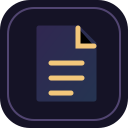

# KeepLite — личный цифровой блокнот

<h2 align="center">KeepLite · Mirror- Studio</h2>

Ваше пространство для мыслей, планов и небольших дел.

<a href="https://lina1209.github.io/InkFlow/"><strong>✨ Открыть приложение</strong></a> · <a href="https://github.com/Lina1209/InkFlow">Исходный код</a>

KeepLite — адаптивный русскоязычный блокнот, который работает в браузере и поддерживает установку как PWA.

## Возможности
- Заметки с заголовком и текстом; быстрая запись.
- Предупреждение о несохранённых изменениях при закрытии редактора.
- Чек-листы с отметками выполнения.
- Папки с переименованием и безопасным удалением (заметки сохраняются), теги, закрепление и архив.
- Корзина с восстановлением и окончательным удалением.
- Поиск по содержимому, заголовкам, тегам и пунктам списков.
- Сортировка по дате изменения, создания или названию.
- Резервная копия всего пространства в JSON и восстановление из файла.
- Локальное хранение в IndexedDB; перенос старых записей из `keeplite_notes`.
- PWA-оболочка с кешированием интерфейса для повторного офлайн-открытия.

## Приватность и ограничения
Приложение не требует регистрации и не отправляет заметки на собственный сервер. Данные привязаны к браузеру и устройству. Очистка данных сайта или потеря устройства может привести к их утрате — регулярно скачивайте JSON-копию и храните её отдельно. Облачная синхронизация между устройствами пока не реализована.

## Установка
Откройте [KeepLite](https://lina1209.github.io/InkFlow/) и выберите в меню браузера «Установить приложение» или «Добавить на главный экран», если пункт доступен. Для офлайн-кеша откройте сайт онлайн хотя бы один раз.

## Файлы
- `index.html` — интерфейс и логика.
- `manifest.webmanifest` — параметры PWA.
- `sw.js` — кеширование оболочки.
- `icon.svg` — иконка.

**KeepLite — проект Mirror- Studio · Lina1209 ©**
