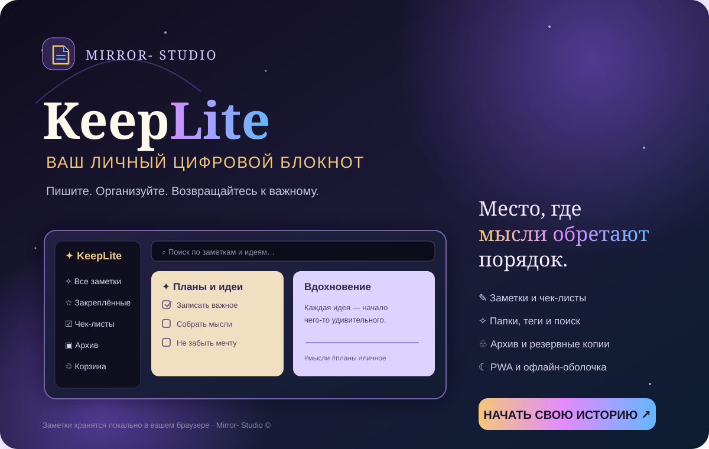

# KeepLite — ваш личный цифровой блокнот

  

  <strong>Пишите. Организуйте. Возвращайтесь к важному.</strong> 
  Лёгкое пространство для мыслей, планов, списков и вдохновения.

  <a href="https://lina1209.github.io/InkFlow/"><strong>✦ Открыть KeepLite</strong></a>
  ·
  <a href="https://github.com/Lina1209/InkFlow"><strong>Исходный код</strong></a>
  ·
  <a href="https://github.com/Lina1209/InkFlow/issues"><strong>Сообщить о проблеме</strong></a>

---

## ✨ Ваши идеи заслуживают красивого пространства

KeepLite — адаптивный русскоязычный блокнот, который работает прямо в браузере. Создавайте заметки, собирайте планы, раскладывайте мысли по папкам и быстро находите нужное. Интерфейс подстраивается под телефон, планшет и компьютер.

### Что умеет KeepLite

| Возможность | Что это даёт |
|---|---|
| **Быстрая запись** | Сохраните мысль, пока она не убежала. |
| **Заметки и чек-листы** | Храните тексты, планы и списки дел в одном месте. |
| **Папки и теги** | Собирайте записи по темам и проектам. |
| **Поиск и сортировка** | Находите нужное по заголовку, тексту, тегам и пунктам списков. |
| **Закрепление и архив** | Держите важное под рукой, а завершённое — в порядке. |
| **Корзина и восстановление** | Верните случайно удалённую заметку или удалите её окончательно. |
| **Резервная копия** | Экспортируйте всё пространство в JSON и восстановите его из файла. |
| **Текстовый экспорт** | Сохраните заметки в TXT. |
| **PWA-оболочка** | Установите приложение на устройство; интерфейс кешируется для повторного офлайн-открытия. |

## 🌙 Личное пространство — без лишних барьеров

- Регистрация не требуется.
- Заметки хранятся локально в браузере на вашем устройстве.
- Приложение не отправляет содержимое заметок на собственный сервер.
- Интерфейс адаптирован для мобильных экранов.
- После первого открытия онлайн PWA-оболочка может открываться без подключения к сети.

**Важно:** локальное хранение — это не облачная синхронизация. Данные не переносятся автоматически между устройствами. Очистка данных браузера или потеря устройства может привести к их утрате. Регулярно создавайте JSON-копию и храните её отдельно.

## 🚀 Как начать

1. Откройте [KeepLite](https://lina1209.github.io/InkFlow/).
2. Нажмите «Новая» или используйте поле быстрой записи.
3. Добавьте папки и теги, чтобы навести порядок.
4. На телефоне откройте меню браузера и выберите «Установить приложение» или «Добавить на главный экран», если такая команда доступна.
5. Создайте резервную копию в меню приложения.

## 🧭 Клавиши быстрого доступа

- **Ctrl / ⌘ + N** — новая заметка.
- **Ctrl / ⌘ + K** — перейти к поиску.
- **Enter** в поле быстрой записи — сохранить запись.
- **Esc** — закрыть окно редактирования (с предупреждением о несохранённых изменениях).

## 🛠️ Технологии

Самостоятельный HTML/CSS/JavaScript-интерфейс без внешних CDN-зависимостей, IndexedDB с резервным режимом localStorage, Web App Manifest и Service Worker.

## 📦 Состав проекта

- `index.html` — интерфейс и логика приложения.
- `manifest.webmanifest` — параметры установки PWA.
- `sw.js` — кеширование оболочки.
- `icon.svg` — иконка.
- `assets/keeplite-poster.svg` — постер проекта для README и релизных материалов.
- `scripts/smoke-test.mjs` — базовые автоматические проверки.

## 🗺️ Что дальше

KeepLite развивается. Среди направлений дальнейшей работы — полноценные браузерные и мобильные проверки, дополнительные форматы импорта/экспорта, улучшение доступности и новые способы организации заметок. Облачная синхронизация не входит в текущую версию.

## 💜 Проект

**KeepLite — Mirror- Studio · Lina1209 ©**

Если проект оказался полезен, поставьте ⭐ репозиторию на GitHub и поделитесь им с теми, кому нравится держать идеи в порядке.
