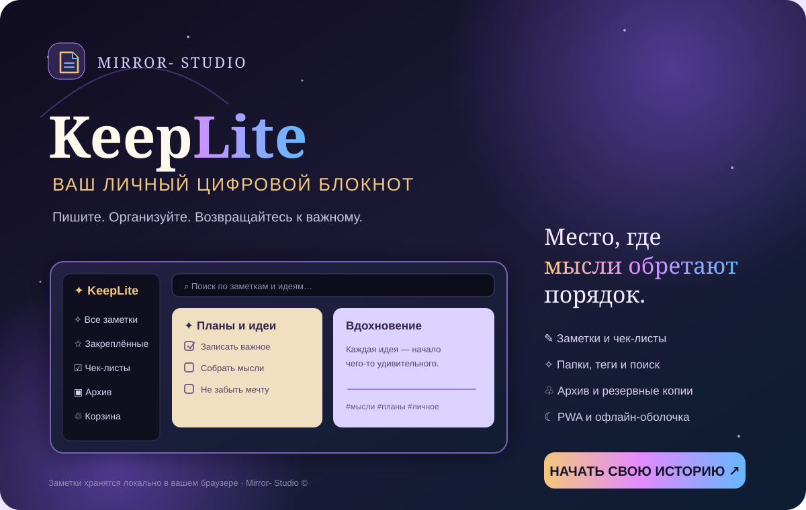

# KeepLite v1.0.0 — первое публичное представление

> Пишите. Организуйте. Возвращайтесь к важному.

## В этом выпуске
- Адаптивный русскоязычный блокнот.
- Быстрая запись, заметки и чек-листы.
- Папки, теги, закрепление, поиск и сортировка.
- Архив, корзина и восстановление.
- JSON-резервная копия, импорт и TXT-экспорт.
- Локальное хранение в IndexedDB с резервным режимом.
- PWA-оболочка для повторного офлайн-открытия.

## Важно знать
Заметки хранятся в браузере на устройстве пользователя. Автоматической синхронизации между устройствами нет. Регулярно сохраняйте резервную копию JSON.

Открыть приложение: https://lina1209.github.io/InkFlow/

## Проект и авторство

**Lina1#09 · Mirror-Studio ©**

- Сайт: https://lina1209.github.io/InkFlow/
- GitHub-репозиторий: https://github.com/Lina1209/InkFlow
